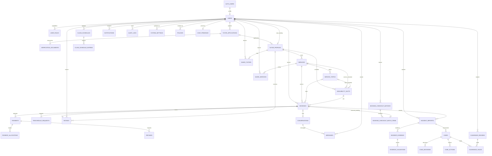

# Admin integration and verified system relationships

Inspected on October 14, 2026. The active routes are defined in `src/router/index.jsx`.
The attached SQL is schema context, not an executable migration. Relationships below
were checked against the connected database's foreign keys and existing RPC definitions.
No standalone ERD file was present; this diagram reconstructs the relevant ERD.
The source tree also contains earlier static layouts; those are not the routed portals.

## Roles and actual data flow

| Workflow                               | Existing source                                                                                     | Admin integration                                                                                                                                                                                                       |
| -------------------------------------- | --------------------------------------------------------------------------------------------------- | ----------------------------------------------------------------------------------------------------------------------------------------------------------------------------------------------------------------------- |
| Sign-in and authorization              | `AuthProvider`, `loadAuthAccount`, `users`, active `user_roles`                                     | Uses the actual roles and account status; every Admin database operation checks active Admin authorization.                                                                                                             |
| Tutor application and approval         | `submit_tutor_application`, `review_tutor_application`; applications, documents, profiles and roles | Retains the existing manual review/OCR workflow. Refreshes applications, newly approved Tutor roles, profiles and audit logs together.                                                                                  |
| Service creation and editing           | `save_tutor_topic_service` and `tutorServices.js`                                                   | One Service title / Subject. Topic rates, types, meeting details and dated/weekly availability come from the linked topic/slot records. Legacy category remains in storage but is not an Admin input, column or filter. |
| Tutor availability and class schedules | Tutor availability RPCs, schedule upload/review, class entries                                      | Displays saved topic availability; preserves the existing class/conflict validation and booking protection.                                                                                                             |
| Learner discovery and saved services   | `find_tutor_services`, `get_service_topic_settings`, `saved_services`                               | Moderation changes the existing service status. Existing discovery rules exclude inactive/suspended services. Tutor-owned content remains read-only for Admin.                                                          |
| Booking and multi-session checkout     | `create-payment`, reservation RPCs, checkout batches and items                                      | Reads all bookings, including unpaid reservations. Joins the Learner by `learner_id` and the Tutor through service/profile IDs.                                                                                         |
| Payment confirmation                   | Existing signature-verified PayMongo webhook and restricted finalization RPCs                       | Reads payments separately from bookings. Successful payment totals include confirmed and completed sessions, not just completed ones. No provider confirmations are manufactured.                                       |
| Session completion                     | `complete_tutor_session`, paid Tutor/Learner session RPCs                                           | Reflects the explicit stored status. Passing the scheduled end time does not automatically make a booking completed.                                                                                                    |
| Learner reviews                        | `save_my_learner_review`, rating records                                                            | Linked booking details display rating, comment and visibility.                                                                                                                                                          |
| Refunds, reschedules and incidents     | Existing tables and relationships                                                                   | Displays persisted records, linked bookings, actual refund amounts and review decisions. Admin review does not execute a provider refund or change session schedules.                                                   |
| Audit history                          | Existing `audit_logs`, application review audit writes                                              | Displays real database events and adds future workflow events from Tutor/Learner writes and payment finalization. Historical events are not fabricated.                                                                 |

Names and student IDs are display fields. Joins use the actual UUID/bigint foreign keys;
two accounts with the same name remain distinct. Booking title/subject/topic snapshots
and charged amounts remain historical even if the Tutor edits the current listing.

## ERD

The arrows below show database relationships, not automatic application actions.
Nullable reviewers/owners and auxiliary user references are summarized after the diagram.



User UUIDs also identify document/application reviewers, profile verifiers, refund
requesters/processors, incident subjects/assigned Admins, evidence submitters/reviewers,
OSAS case assignees/archivers, decision/action authors and clearance reviewers/hold authors.
`audit_logs.target_id` is a bigint, so UUID user targets are retained in the JSON payload.
The live database has delete rules and protection triggers not shown in the pasted schema;
those were preserved, including booking snapshots and overlap/deletion protection.

## Read, refresh and financial behavior

`admin_dashboard_snapshot()` checks the active Admin account and returns the core shared
Admin read data in one SQL statement. It uses the configured Supabase project; no
service-role key is shipped to the browser. A failed read is an error, not an empty
successful dataset. A refresh error retains the last successful snapshot with an alert.

`useAdminRecords` refreshes on navigation, focus, session-change events, visibility
changes, and every 15 seconds while visible. Request sequencing prevents older requests
from replacing newer data. Saves and application decisions refresh the shared records.
Unchanged configuration keeps its object identity so polling does not discard a draft.

Reports use the current Manila month rather than a fixed September 2026 date. Service
filters use service IDs; college filters follow linked accounts. Session-date filters
apply to bookings. Paid dates (or creation dates for unpaid transactions) apply to payments.
User totals are cumulative through the end date. Current Tutor-role counts are not
presented as reconstructed historical role states.

Recorded `payment_allocations` take precedence. The inspected database had no allocation
rows, so the existing 90/5/5 rule is shown explicitly as an estimate for paid payments.
It is not presented as a recorded distribution or payout. Pending refund reviews are
excluded from settled totals. An approval is a review decision, not a PayMongo refund.

## Audit behavior and deployment

`202610140002_admin_workflow_alignment.sql` adds the snapshot and future workflow-audit
triggers without replacing Tutor/Learner RPCs or their RLS policies. Status-only changes,
service/topics/schedule edits, payment finalization, reviews, refunds and reschedule
requests are captured. Timestamp-only updates do not generate redundant events. Explicit
Admin reviews suppress the generic trigger so one review produces one business audit.
Existing application-review audit writes remain intact. Actor-less provider writes are
shown as System / payment provider. IP/device fields are shown only when recorded.

The migration was applied to the project already linked to the app after rollback-only
validation. Database lint passed. The earlier applied migration remains immutable.

## Validation

- 44 Node tests passed, including 8 new Admin data-flow cases and the existing Tutor,
  Learner, topic availability, reviews, checkout and session lifecycle suites.
- Browser checks used an authenticated fixture and an actual database snapshot, with
  HTTP responses intercepted to prevent browser mutations of real accounts/payments.
  Service/topic details, four bookings, three payments, current Tutor-role counts,
  current-month reports, audit details, focus refresh, polling and refresh errors passed.
- `supabase/tests/admin_workflow_integration.sql` exercised the deployed database functions
  and RLS with existing active Admin/Tutor/Learner identities. Tutor status writes,
  session completion, audit capture, notifications, stale-review rejection and access
  denial passed. All fixtures/mutations were rolled back.
- `npm run build` passed. Tutor/Learner source files and payment Edge Functions were not changed.

Run Node checks:

```sh
node --test src/services/*.test.mjs src/components/tutor/workspace/*.test.mjs supabase/functions/create-payment/*.test.mjs
npm run build
```

On a seeded development/staging database with active Admin, Tutor and Learner accounts:

```sh
supabase db query --linked --file supabase/tests/admin_workflow_integration.sql
supabase db lint --linked --level error
```

## Existing boundaries found during inspection

Learner/Tutor cancellation, rescheduling and incident submission still contain unconnected
adapters in the existing workspaces. Admin reflects persisted table records; it cannot
reflect an action that those adapters never save. This update does not invent those records
or replace the working Tutor/Learner flows. It does not initiate real provider transactions.

Admin setting preferences are persisted. Institution-password changes, two-factor
configuration, maintenance enforcement and notification-delivery services are separate
existing integrations; storing preference flags does not implement those mechanisms.
Service change requests create a `notifications` row; the existing Tutor inbox currently
builds its UI from session/chat events rather than reading every stored notification type.

## Browser storage policy

CampusTutor business records are not saved to localStorage, sessionStorage or IndexedDB.
The retired browser-cache cleanup utility and its startup call have been removed.

Supabase authentication tokens and OAuth code verifiers are retained so reloads and
institutional sign-in continue to work. Database connection environment variables remain
configuration, not a local record store. Explicit CSV/PDF exports are downloads requested
by the user, not app persistence.

Inbox read badges use React state only and reset when the page reloads. Reading actual
booking messages still updates their read state in the database. Saved tutors, services,
schedules, bookings, payments and Admin records continue using Supabase.

## Manual transfer records

Paid Date and Allocation Source are shown inside View Transaction, not the transaction
list. Mark as Transferred records an already completed external transfer with one click from the transaction table. A success toast appears only after the database confirms the update. The paid transaction keeps its original payment status;
transfer status, timestamp, Admin identity are stored separately in payments. A reference is optional; no receipt reference is manufactured.
The operation requires an active Admin, rejects unpaid payments and outstanding refunds,
prevents duplicate transfer records, and adds a database audit entry. It does not send money.

`supabase/manual/payment_transfer_record.sql` was applied to the connected database.
The existing remote migration history was preserved when the local migrations directory
was absent. No existing transactions were marked during implementation; validation used
rollback-only updates.

## Payment-first booking visibility

The booking wizard keeps selections in component state; closing and reopening starts a fresh draft.
It does not reserve database rows until the final payment submission. Checkout reservations are
excluded from Admin bookings, transactions, dashboard totals and analytics until paid (previously
paid refunded records remain visible). Earlier wizard steps can proceed while checkout cleanup is
being checked; payment submission rechecks previous reservations on the server.

On cancellation return or reopening the wizard, abandoned checkouts are expired with PayMongo
before their unpaid bookings, payments and batch rows are removed using the existing discard RPC.
A genuinely processing payment cannot be deleted. A provider-paid checkout with a delayed webhook
is verified against the reserved amount, currency, payment method and checkout line items, then
finalized through the existing payment RPC. The current request is preserved during idempotent retries.
Temporary database reservations still exist during payment to prevent two learners buying the same
slot; they are not presented as completed orders. The updated create-payment function was deployed.

## Transferred payouts and recorded shares

Admin Payments replaces the Pending tab with Transferred, filtering the recorded transfer timestamp.
`supabase/manual/payment_transfer_shares.sql` was applied to the connected Supabase database.
Mark as Transferred now stores a missing 90/5/5 allocation in the same transaction as the manual
transfer record. Existing allocations are preserved, cent rounding keeps all shares equal to gross,
and repeated requests cannot create duplicate allocations. Provider payment status remains paid.
This records an externally completed manual distribution; it does not initiate money transfers.

The Tutor sessions RPC includes actual payment references, recorded shares and transfer timestamps.
Earnings shows transferred paid sessions even before session completion, marks them Transferred,
and includes their stored shares in totals. Existing completed paid sessions remain visible.
Tutor polling every 15 seconds and window focus refresh bring Admin updates into the open workspace.
Validation used rollback-only database checks for shares, idempotency, provider status and Tutor
visibility; no real payment was marked transferred during validation. Production build passed.
