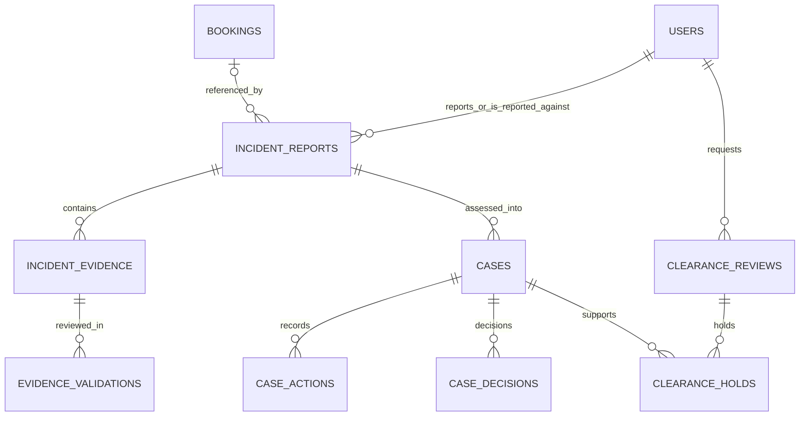

# OSAS reporting integration

The active OSAS route is `src/components/osas/OsasDashboard.jsx`, protected by
`AuthRoutes.jsx`. The other dashboard/layout prototypes are not routed. The existing
Supabase project, public browser credentials and passwordless authentication configuration
are unchanged. No service-role credentials were added to the frontend.

The supplied schema was treated as reference material, not executed. Its reporting
relationships were checked against the linked database, existing RPC definitions,
RLS policies, Storage buckets and migration history. Historical remote migrations
`202610140001` and `202610140002` were preserved; no migration-history repair was performed.

Reports store the reporter and reported party as UUIDs. A booking joins its service,
then its tutor profile to obtain the tutor's user ID. The report RPC determines the
other participant; client-supplied names or reported-party IDs never establish ownership.
Case IDs, report IDs, evidence IDs and clearance IDs retain their actual database keys.
Clearance matches the reported student by UUID, including when people share names.

## Submission and review

Learner Session Details, the Learner report dialog, Tutor Session Details and both
roles' booking-chat reports use `submitIncidentReport`. The existing
`report_booking_chat` RPC is retained as a compatibility wrapper. Reporting requires
an active participant in a paid, refunded or partially refunded booking whose status
is confirmed, completed or cancelled, matching the existing `can_chat_booking` rule.
The previous unsupported conversation-only option was removed: all existing chat
conversations belong to bookings. No arbitrary user-report relationship was invented.

Descriptions require 20–2000 characters. Up to five attachments (PNG/JPEG/PDF up to 10 MB each, or MP4/WebM/MOV video up to 50 MB each) are uploaded to the private `incident-evidence` bucket. Paths contain the
authenticated user UUID, an idempotent submission key and a content hash. The database
verifies the uploaded objects before recording the report and its evidence rows together.
Failed submissions attempt to remove staged objects; RLS prevents removal of evidence
already linked to a submitted report. An interrupted upload may still leave a private
staged object; a future retention job can remove unlinked uploads according to office policy.

New reports start `submitted / not_referred`. They appear in Admin monitoring and OSAS
Incident Monitoring, where the latter labels them Awaiting Admin Screening. OSAS can
view their original narrative and evidence. Admin handles Platform / Technical concerns
or screens and refers other concerns using the existing Admin review RPC. OSAS cannot
open a formal case or close a referral before that referral is recorded.

After referral, OSAS can open a case assigned to the authenticated officer, or close the
report without a formal case and save assessment notes. Case notes, evidence requests,
status transitions, decisions, condition completion and archiving use `osas_save_record`.
Evidence validations persist all six existing database criteria, reviewer identity and notes.
Unvalidated evidence blocks Pending Decision. A decision requires an outcome, substantive
notes and institutional basis. Resolved decisions are immutable except for recording
condition completion. Archiving requires resolution and completed conditions; archived
case records and their evidence cannot be edited. Admin cannot change reports once an
OSAS case exists. No action automatically suspends an account or establishes misconduct.

OSAS clearance reviews persist in `clearance_reviews`. On Hold requires a recorded
case recommendation and creates a linked `clearance_holds` row. Holds cannot be released
until the relevant case and conditions are resolved; release requires recorded notes.
Cleared is blocked by unresolved cases, conditions or active holds. Review identity,
timestamps, case actions, decisions and OSAS audit events come from the database.

Submission receipts, case decisions and evidence requests create actual in-app
notifications. Email delivery is not implemented; saved email preferences do not send mail.
OSAS referral, clearance-request and evidence-submission notices respect the corresponding
in-app preferences. The header reads actual notification rows and persists their read state.
Evidence requests identify the recipient by UUID. Learners and Tutors can upload follow-up
files from the request notification. `attach_incident_evidence` checks active participation,
locks the case, rejects resolved/archived cases, links new files to the original report and
returns the case to Under Review. Retrying the same file paths does not duplicate evidence.

## Database and frontend components

`supabase/manual/osas_integration.sql` was applied to the linked Supabase database. It adds
the submission key, assessment details, guarded RPCs, OSAS read policies, participant
write protections, clearance-request initial-state protection, private evidence bucket
policies and the report review guard. RPCs have an empty search path, verify active roles,
and revoke anonymous execution. Direct report/evidence inserts cannot bypass the RPC.
Ordinary users cannot read institutional cases, decisions or validation records. Existing
participant report reads and Admin reads are retained, with inactive-account read guards.

`OsasDatabaseContext.jsx` loads `osas_dashboard_snapshot`, refreshes every 15 seconds and
on window focus, and refreshes after successful mutations. `osasRecords.js` maps the actual
relationships and rejects incomplete snapshots. Failed requests display errors instead
of claiming that the database has no records. OSAS overview, incidents, cases, evidence,
clearance, archive, policies and analytics use this shared source. Fixed September filters,
sample policy narratives, fictional student IDs and sample evidence previews were removed.

Financial analytics use stored payment allocations for completed paid sessions or recorded
transfers. Case charts use actual types and priorities. Academic filters apply to clearance
records; case and financial dates do not imply an unrecorded academic-year relationship.
Settings are stored per officer in `system_settings`; they do not change authentication
security. Policies are read-only and use their stored document URL. The database currently
has no policy rows, so no institutional rules or documents were manufactured.

## Validation and deployment

- Seven temporary Node checks covered report payload ownership, hashed private evidence paths,
  failed-submission cleanup, invalid input, UUID-based clearance links, malformed snapshots and
  follow-up evidence routing.
- Rollback-only SQL checked Learner/Tutor submission, duplicate-request handling, unrelated-user
  rejection, Admin referral, OSAS assessment, evidence validation, decisions and archival locks.
- Separate rollback-only checks covered conditions, clearance holds, release and clearing,
  authenticated RLS, anonymous RPC grants and follow-up evidence recipients/retry/closure rules.
- Chrome/Playwright with intercepted Supabase responses checked OSAS navigation, report
  rendering, formal-case creation, note saving and evidence validation. Separate browser
  harnesses submitted both Learner and Tutor forms with an actual PNG input and checked
  their booking/evidence RPC payloads. Browser fixtures did not mutate the live database.
- Production build, database lint and `git diff --check` passed. The build retains its existing large-chunk warning.

No real report, case, decision or clearance request was created by validation. The database
installation is complete. Deploy the updated Vite frontend through the normal hosting
workflow; no new Edge Function deployment is required. On another Supabase project, apply
the SQL file after its existing CampusTutor schema before deploying the frontend.

Video evidence support: `supabase/manual/incident_evidence_video.sql` updates the existing private bucket, upload extension policy and both reporting RPCs. RPCs verify stored object MIME and size against submitted metadata. Messages, learner/tutor session reports and follow-up evidence share the same picker. Admin/OSAS previews use signed URLs and video controls; playback depends on browser codec support, with an original-file link available. This patch was applied to the linked database.

Every new incident report requires 1?5 evidence files. Shared report forms, client submission validation and the database RPC enforce this rule. Apply `supabase/manual/incident_evidence_required.sql` to upgrade an existing installation; already submitted reports remain unchanged.

Avatars: `supabase/manual/avatars.sql` configures the private `avatar` bucket and owner/role-checked upload RPCs. Paths are `<learner|tutor|admin|osas>/<auth-user-id>/<uuid>.<jpg|png|webp>`; folders appear on first upload. JPG/PNG/WebP up to 5 MiB. `users.profile_image` stores the object path, and all roles share the account picture. Headers and learner/tutor profile views allow upload; shared avatar displays load signed URLs. No browser persistence is used.

OSAS navigation now consolidates Incident Monitoring and Evidence Validation into Case Review. Reports & Referrals opens assessments/formal cases; Formal Cases opens the case drawer with its inline Validate Evidence form. Validation requires an active formal case. Workflow prerequisites, OSAS authorization and database RPCs remain enforced. Admin navigation retains its separate Tutor Verification and Service Management sections.
